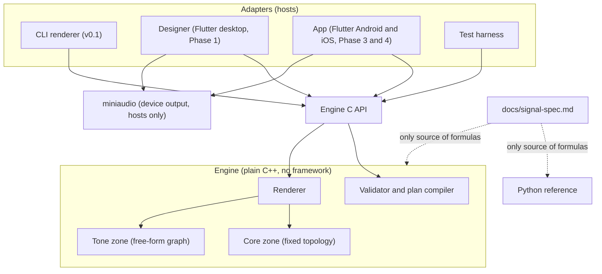
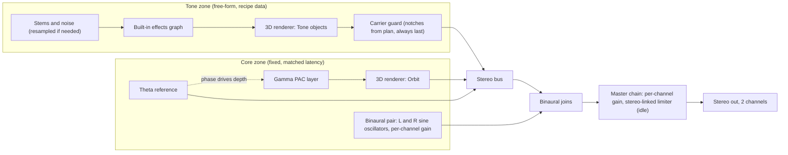
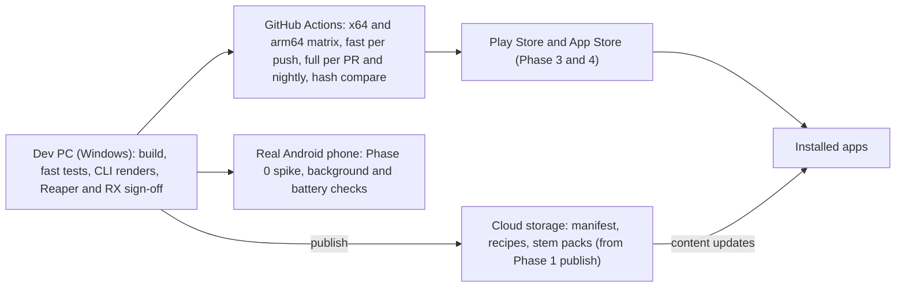

# Architecture Spine: Arcani

**Review status.** ADs marked `[REVIEW PENDING]` and the Stack table lock only after the independent review CLAUDE.md rule 4 requires. Until then they bind v0.1 work as written; a change goes through the memlog and the design log.

## Design Paradigm

**Functional core with adapters (hexagonal).** The engine is a pure, deterministic function: render plan + assets + seed + sample index in, samples out. It owns no threads, devices, files, network, or UI. Every host (CLI renderer, designer, Android app, iOS app, test harness) is an adapter around the same engine through one C API.

Inside the engine, sound is split into two zones:

- **Core zone:** the entrainment signals (theta reference, gamma PAC layer, binaural layer). Topology is fixed in code. Recipes set parameters inside locked ranges and never set routing.
- **Tone zone:** stems, music, ambience, noise, and built-in effects. Routing is free-form data in the recipe, so each track gets its own character. It never reads or feeds the Core zone.



Dependency direction: hosts depend on the C API; the C API depends on the engine; the engine depends on nothing outside `engine/` except the C++ standard library (no libm transcendentals, see AD-9). miniaudio is used by hosts, never by `engine/`. The Python reference depends on the signal spec and recipe JSON, never on engine code.

## Invariants & Rules

### AD-1: The engine is a pure deterministic core [ADOPTED]

- **Binds:** engine, all hosts (FR-6, FR-11, FR-20, FR-35)
- **Prevents:** hosts embedding DSP, device or thread state leaking into output, the designer and app sounding different from a render.
- **Rule:** Code under `engine/` has no dependency on threads, clocks, devices, files, network, UI, or any framework. Its output is a function of (plan, assets, seed, sample rate, sample index) only. Seeking to a sample index is a pure function of those inputs. Audio I/O, file I/O, and UI live in host adapters. No host performs synthesis or mixing of its own.

### AD-2: Recipes reach the renderer only as validated, immutable plans [ADOPTED]

- **Binds:** validator, renderer, CLI, designer, publish (FR-7 to FR-10, FR-21, FR-23)
- **Prevents:** a code path that renders an unvalidated recipe; a second validator drifting from the first.
- **Rule:** The engine's compiler turns a recipe into an immutable render plan; the renderer accepts only a plan. Compile returns blocking errors (parameter, value, rule, limit; no plan) and non-blocking structured warnings (for example a non-sine binaural waveform, FR-4). Compile modes: `measure` (loudness gain may be absent; used only by the exporting tool), `audition` (stale gain allowed, with a warning), and `final` (everything enforced; required for render to golden, export, and publish). No host implements its own validation; the designer calls the engine compiler for every check.

### AD-3: Core zone topology is fixed in code; Tone zone routing is data [ADOPTED]

- **Binds:** engine, recipe schema, designer (FR-2 to FR-5, FR-18, FR-24)
- **Prevents:** free routing reaching an entrainment layer; the designer exposing Core wiring.
- **Rule:** The recipe schema has no routing fields for the Core zone, only parameters. The Tone zone is a directed graph of stem sources and built-in effects described in the recipe. No Tone graph node can take a Core signal, Core state, or the binaural path as input.

### AD-4: Fixed mix order, binaural joins last, limiter stays idle [ADOPTED] [REVIEW PENDING]

- **Binds:** engine mix stage, 3D renderer, master chain (FR-4, FR-5, FR-25, FR-27)
- **Prevents:** the binaural pair passing through any spatial, HRTF, ambisonic, reverb, width, or channel-mixing stage (the bug that broke an earlier project); limiter gain modulation reaching the binaural pair.
- **Rule:** The mix order is fixed as drawn in *Signal flow*. The binaural path is two sine oscillators and per-channel gain, summed into the stereo bus after every spatial and effect stage. The master chain contains only per-channel gain and a stereo-linked limiter, with its algorithm in the signal spec; no mid/side, crossfeed, width, matrix, or any operation that mixes channels. At the stored loudness gain the limiter must stay idle: its gain reduction stays under a bound set in the design log, asserted on every render. The engine never sums or downmixes its output channels. A structural test checks the stage list; the signal isolation test (FR-4) checks the output.

### AD-5: Gamma couples only to the theta reference [ADOPTED] [REVIEW PENDING]

- **Binds:** gamma PAC layer, recipe schema, validator (FR-3, FR-4)
- **Prevents:** gamma coupled to a binaural beat, which has no waveform in the file.
- **Rule:** Gamma modulation depth is a function of the theta reference phase only, as defined per envelope shape in the signal spec. The schema has no coupling-target field. The validator rejects coupled gamma wherever gamma depth is non-zero while the theta reference is absent or at zero depth. Test: changing the binaural beat rate or phase leaves every gamma envelope peak time unchanged to the sample.

### AD-6: The Tone zone never reads Core timing and carries no entrainment-rate rhythm

- **Binds:** Tone zone, stem sequencer, stem motion, effects, stem curation (FR-24, FR-26, FR-27)
- **Prevents:** ambience becoming an untracked entrainment signal through motion, effect LFOs, gating, or baked-in pulses.
- **Rule:** The Tone zone runs on its own musical clock and reads no Core clock, phase, or envelope state. Every time-varying Tone parameter (object motion, effect LFOs, gates, tempo-synced effects) has a locked rate range traced to the design log, enforced by the validator. The stem curation checklist screens baked stems for periodic level changes at entrainment rates. Tone sync to Core timing is revisited only after the PRD Q9 patent check.

### AD-7: No third-party plugin code runs in the engine

- **Binds:** Tone zone effects, designer, stem pipeline (FR-24, FR-26)
- **Prevents:** designer and phone sounding different; plugin output that cannot be reproduced or run on mobile.
- **Rule:** Effects come in two tiers. Baked: any third-party plugin is applied offline in a DAW and printed into the stem file; the file is the artifact. Live: only engine-owned effects run at playback. "Engine-owned" means written for the engine, or vendored source compiled under AD-9 rules and proven bit-exact. The engine links no plugin-hosting code.

### AD-8: 3D audio is rendered by the engine, never the device

- **Binds:** 3D renderer, Orbit layer, stems, app output (FR-27, FR-28, FR-34)
- **Prevents:** device or Atmos spatializers deciding the sound; HRTF applied to the binaural pair; motion shifting frequencies.
- **Rule:** One engine-owned 3D object renderer places and moves the gamma PAC layer (Orbit) and Tone zone stems (static or moving, per recipe). The theta reference and binaural layer never enter it. Motion applies no Doppler or pitch shift. The engine outputs plain stereo. No head tracking in v1. The app never hands audio to an OS or Dolby spatializer.

### AD-9: The engine is bit-exact across platforms [REVIEW PENDING]

- **Binds:** all engine code: Core, stem decoder, resampler, built-in effects, 3D renderer (FR-6, FR-35)
- **Prevents:** PC, Android, and iOS producing different samples for the same plan.
- **Rule:** Engine code uses engine-owned math for sine and every transcendental (no libm), 64-bit integer phase accumulators, and no `long double`. Every toolchain compiles the engine with `-ffp-contract=off` and no fast-math (clang-cl through `/clang:`), and CI fails if the flags are missing. The engine sets its own denormal mode on entry to each render call. Android ships arm64-v8a only. Stems decode through an engine-owned decoder, never the OS. CI renders on Windows x64 (clang-cl), Linux or Windows arm64 (Clang), macOS arm64 (Apple clang), and an Android NDK arm64 build on emulator or device, and compares hashes. A component the Phase 0 spike proves cannot be exact falls back to the -100 dBFS tolerance, with the reason in the design log.

### AD-10: Output is independent of block size; native 44.1 and 48 kHz

- **Binds:** renderer, all hosts, stem playback (FR-6, FR-11, FR-20)
- **Prevents:** host callback size or device rate changing the samples.
- **Rule:** The renderer processes in a fixed internal block, size set in the signal spec, and buffers to whatever the host asks for. Rendering at 1, 64, 512, and 4096 frames per call yields identical bytes. The Core renders natively at 44.1 and 48 kHz and is never resampled. Tone zone stems whose rate differs from the output rate pass through an engine-owned deterministic resampler. Recipe and spec time values are in seconds and convert to samples by one rule in the spec. Byte identity is per sample rate; tests and golden files cover both.

### AD-11: Real-time contract on the audio thread

- **Binds:** engine render call, designer, app (FR-20, FR-22, FR-30)
- **Prevents:** dropouts from allocation or locks; UI work stalling audio; clicks from live edits.
- **Rule:** The render call never allocates, locks, blocks, or does I/O. Hosts change sound only by submitting a new plan; the engine swaps it at a block boundary with gain ramps of at least 10 ms and continuous Core phase. Hosts read engine state only from a snapshot the engine publishes without locks. Plans are reference-counted by the engine; a host releases its handle and the engine frees the plan off the audio thread. Render identity is guaranteed for an unedited plan.

### AD-12: One small C API is the only way into the engine

- **Binds:** engine, CLI, designer, app, C++ tests (FR-11, FR-18 to FR-22, FR-29)
- **Prevents:** hosts reaching engine internals; Flutter and the CLI using different entry points.
- **Rule:** All hosts, including Flutter through dart:ffi, use one C API with a stable ABI: provide asset, compile recipe (with mode), render frames, seek, submit plan, read state snapshot, read per-layer taps (offline only), read warnings, engine version. Errors return a status code plus a structured error (parameter, value, rule, limit).

### AD-13: Loudness gain is measured at export and stored in the recipe

- **Binds:** CLI (v0.1), designer, validator, test suite (FR-5, FR-23; resolves PRD Q6)
- **Prevents:** live playback and offline renders reaching the loudness target by different routes.
- **Rule:** The exporting tool (the CLI in v0.1, the designer from Phase 1) compiles in `measure` mode, renders, measures integrated loudness over the window the signal spec defines (for looping recipes: ramp-in plus one body), and writes the gain and a loudness hash into the recipe. The loudness hash covers the schema fields tagged as loudness-relevant plus asset hashes. `final` compile rejects a missing gain or a mismatched hash. Live and offline use the same stored gain; listener intensity (FR-31) scales after it. Each recipe names its loudness target, set from the design log. The test suite confirms within 1 LU.

### AD-14: One seed drives all randomness, through a counter-based generator

- **Binds:** engine, stem sequencer, WAV writer (FR-6, FR-24)
- **Prevents:** unseeded randomness; draw order depending on loops, seeks, or plan swaps.
- **Rule:** All randomness comes from an engine-owned counter-based PRNG: each value is a pure function of (seed, stream name, index). Each consumer has its own named stream. No other randomness source exists in engine or render output code. v0.1 WAV output rounds to 24 bits without dither; any later dither uses its own named stream.

### AD-15: Recipes and engine are versioned; golden files are keyed and signed off

- **Binds:** recipe schema, engine, golden files, content updates (FR-7, FR-14, FR-17, FR-33)
- **Prevents:** an engine silently reinterpreting an old recipe; golden files drifting or appearing without sign-off.
- **Rule:** Every recipe declares a schema version and an engine version. The engine rejects a schema major version it does not support. A golden file is keyed by the determinism key (AD-21) and matches byte for byte; for a component on the AD-9 fallback, cross-platform comparison uses the -100 dBFS tolerance. A missing golden file fails the run. A golden file is created or replaced only after Audio's recorded sign-off against the listening checklist (Reaper and RX).

### AD-16: The Python reference is independent of the engine [ADOPTED]

- **Binds:** reference renderer, test suite (FR-12, FR-13)
- **Prevents:** the reference sharing the engine's bugs.
- **Rule:** The reference renders from the recipe JSON in double precision, implemented from the signal spec (AD-19), including its phase quantization, and never ported from or linked to engine code. It covers every layer and the master chain v0.1 renders. The comparison uses the engine's pre-quantization float output and per-layer taps, at less than -100 dBFS sample by sample.

### AD-17: One assertion library; every render produces a machine-readable report

- **Binds:** CLI, test suite, CI, designer publish, build agents (FR-11, FR-13 to FR-15, FR-23)
- **Prevents:** agents, humans, and the publish gate judging renders by different evidence.
- **Rule:** One assertion library runs every check in CLAUDE.md and FR-13: binaural isolation, coupling timing, envelope shape, carrier and spacing rules, frequency accuracy, 8-hour drift, reference match, determinism, block-size invariance, clicks, dropouts, NaN or infinite values, gain ramps, limiter idle, loudness and true peak, render speed (reference machine only). The CLI, test suite, and designer publish all call it. Each render writes a report: per assertion name, threshold, measured value, pass or fail, plus determinism key and seed. Thresholds come from one table in the repo, each row traced to the plan or design log. Fast tier (short renders) runs on every push; full tier (8-hour drift, full-length starters, both rates) runs on every pull request into main and nightly. A failure in either blocks merge.

### AD-18: The visualizer is calm and never flickers at entrainment rates

- **Binds:** app UI, designer UI (Phase 3; new scope)
- **Prevents:** visual flicker acting as an untracked entrainment stimulus or a photosensitivity risk.
- **Rule:** The visualizer reads only a slow session-arc snapshot (levels and session position, smoothed below a rate set in the design log), never raw Core phase. It never flashes or pulses at theta, gamma, or beat rates and never exceeds 3 flashes per second (WCAG 2.3.1). It stops drawing when the screen is off.

### AD-19: One signal spec is the only source of formulas [REVIEW PENDING]

- **Binds:** engine, Python reference, validator, tests (FR-1 to FR-12)
- **Prevents:** engine and reference choosing different but reasonable formulas and failing the -100 dBFS match, or a test measuring something different from what the engine makes.
- **Rule:** `docs/signal-spec.md` defines, as exact formulas evaluated per sample: envelope shapes and their 0 degree point, coupling depth function, bursts, ramp and rate-curve laws, phase increment quantization and accumulator width, loop seam behavior, limiter, resampler, internal block size, loudness measurement window, and the spectral component model per shape. Engine and reference implement it; neither defines a formula of its own. A shape or stage not in the spec does not exist.

### AD-20: Carrier and spacing rules come from one spectral component table [REVIEW PENDING]

- **Binds:** validator, test suite, carrier guard, 3D renderer (FR-8, FR-9, FR-25)
- **Prevents:** the validator and the tests disagreeing on what collides; the carrier guard reading Core state at runtime.
- **Rule:** Every modulated carrier is at least 4 times its modulation rate. In each ear, at least the spacing value (50 Hz placeholder, design log (e)) separates any spectral component of one layer from any of another layer, including both binaural carriers; a layer's own components and the binaural pair are exempt. Spectral components (within 40 dB of a layer's strongest line, placeholder) are computed analytically from the spec's component model; the validator checks them across the whole session, including along rate curves. A shape with no component model is rejected. The compiler writes the notch frequencies for the carrier guard into the plan as static data.

### AD-21: One recipe hash and one determinism key

- **Binds:** compiler, golden files, loudness gain, report, content updates (FR-6, FR-14, FR-33)
- **Prevents:** two units hashing the same recipe differently.
- **Rule:** The recipe hash is SHA-256 over the RFC 8785 canonical JSON of the recipe, excluding the stored loudness gain and loudness hash and the non-audio metadata fields the schema marks as excluded. The determinism key is recipe hash + every asset hash the plan pins + engine version + sample rate.

### AD-22: Assets enter the engine only as hashed bytes

- **Binds:** C API, designer, app, content updates, stem encryption (FR-24, FR-32, FR-33)
- **Prevents:** each host inventing its own way to get stems into an engine with no file I/O; a content update silently changing a render.
- **Rule:** Hosts pass asset bytes (decrypted by the host) through the C API, keyed by content hash. The engine verifies the hash and decodes. A plan pins the hash of every asset it uses; a missing or mismatched asset is a compile error.

### AD-23: Hosts output exactly two channels, never downmixed

- **Binds:** designer and app audio adapters, miniaudio build (FR-4, FR-34)
- **Prevents:** a host adapter summing the binaural pair to mono after the engine got it right.
- **Rule:** Hosts open the output device with exactly 2 channels and no channel conversion. A host refuses to play a recipe with a binaural layer on a device that cannot give 2 channels, and tells the listener why. miniaudio is built with decoding and encoding disabled.

### AD-24: Core paths have matched latency

- **Binds:** Core zone, 3D renderer on gamma (FR-3, FR-27)
- **Prevents:** Orbit processing delaying gamma relative to the theta reference and breaking the 2 ms coupling budget.
- **Rule:** Every Core path reaches the stereo bus with the same latency. If the 3D renderer adds latency to gamma, the theta reference and binaural paths are delayed to match. The coupling timing test runs with Orbit on.

### AD-25: Fixed seeds for tooling, a fresh logged seed per play for listeners

- **Binds:** CLI, tests, golden files, designer, app (FR-6, FR-14, FR-24, FR-38)
- **Prevents:** tests that cannot reproduce what a listener heard; consumer sessions that never vary; seeds leaking into analytics.
- **Rule:** The CLI, tests, golden files, and designer audition and export always use the recipe seed. Consumer app builds draw a fresh seed for each play and store it on the device with that play's record, so any play can be re-rendered exactly; the seed is never sent in analytics. Internal app builds may pin a seed. The Core zone draws no random values, so only Tone zone choices vary between plays.

## Consistency Conventions

| Concern | Convention |
| --- | --- |
| Signal names | Carrier, modulation type, rate, everywhere (code, recipe, UI, docs). Binaural form: "binaural, 100 Hz left, 103 Hz right, 3 Hz beat rate". Never a bare rate. |
| Recipe fields | JSON, `snake_case`, units in the field name (`_hz`, `_deg`, `_db`, `_lufs`, `_s`). Times in seconds. Validated against a JSON Schema in the repo; schema tags loudness-relevant and hash-excluded fields. |
| C API | `arc_` prefix; plain C types; status code return; structured error and warning out-parameters. |
| Terms and copy | PRD §3 glossary is binding. CI checks docs, UI strings, and recipe descriptions for: banned terms (CLAUDE.md "Never"), comparables' feature names (PRD §6), health or outcome claims, and em dashes. Research files exempt when citing sources. |
| Clean room | No third-party program names, recipes, recordings, scripts, levels, or session arcs (PRD §6, plan IP rules). |
| Errors and logging | Validator errors name parameter, value, rule, limit. The render call never throws or logs. Hosts log. |
| Thresholds and ranges | One threshold table and one locked-range table in the repo, each row citing the plan or a design log entry. Code reads them; tests never hard-code a number. Never trade a threshold for speed or battery. |
| Workflow | Tests are written first, from acceptance criteria, by a fresh-context QA agent. Never weaken a threshold; propose a change with a reason. No commit with failing tests. Every changed default or threshold gets a design log entry. One story per branch. |
| Golden files | Stored in Git LFS, keyed by determinism key, changed only after listening sign-off. |
| Secrets | GitHub Actions secrets; none in the repo. |

## Stack

| Name | Version |
| --- | --- |
| C++ (engine, CLI) | C++20 |
| Clang: clang-cl (Windows), Android NDK clang, Apple clang | NDK r30; others pinned in the first build story |
| CMake | 4.4.5 |
| Catch2 (C++ tests) | 3.16.1 |
| miniaudio (host audio I/O only) | 0.11.25 at commit 1df46ae or later, `MA_NO_DECODING`, `MA_NO_ENCODING` |
| Python (reference renderer, signal tests) | 3.14 |
| uv | 0.13.6 |
| NumPy | 2.5.4 |
| pytest | pinned in the first build story |
| Flutter (designer and apps, via dart:ffi) | 3.47.1 or later 3.47.x; re-pin at the Phase 0 spike |
| Stem codec | Opus (fixed-point libopus build, vendored) or FLAC; proven bit-exact in Phase 0 |
| CI | GitHub Actions: windows x64, ubuntu-24.04-arm or windows-11-arm, macOS arm64, Android NDK arm64 |

## Structural Seed

### Signal flow (fixed in code)



### Deployment and environments



v0.1 runs only on the dev PC and CI. Content storage appears with publish in Phase 1; stores and accounts in Phase 3.

### Source tree

```text
arcani/
  engine/        # pure C++ core, C API header, no framework
  cli/           # recipe to WAV plus assertion report
  reference/     # Python reference renderer
  tests/         # assertion library, C++ and Python tests, threshold and range tables
  recipes/       # starter and test-fixture recipes, JSON Schema
  golden/        # approved renders (Git LFS), keyed by determinism key
  app/           # Flutter designer and apps (Phase 1 onward)
  docs/          # plan, research library, design log, signal spec, listening checklist
```

## Capability to Architecture Map

| Capability / Area | Lives in | Governed by |
| --- | --- | --- |
| FR-1 to FR-6 engine core and signal layers | `engine/` Core zone | AD-1, AD-4, AD-5, AD-9, AD-10, AD-14, AD-19, AD-24 |
| FR-7 to FR-10 recipes and validation | `engine/` compiler, `recipes/` schema | AD-2, AD-3, AD-13, AD-15, AD-20, AD-21 |
| FR-11, FR-12 renderers | `cli/`, `reference/` | AD-12, AD-16, AD-17, AD-19 |
| FR-13 to FR-15 test suite and CI | `tests/`, CI | AD-9, AD-10, AD-17 |
| FR-16, FR-17 starters and sign-off | `recipes/`, `golden/`, `docs/` | AD-15, Conventions |
| FR-18 to FR-23 designer | `app/` (desktop) over C API | AD-2, AD-11, AD-12, AD-13, AD-17, AD-23 |
| FR-24 to FR-26 stem bed | `engine/` Tone zone | AD-3, AD-6, AD-7, AD-9, AD-14, AD-20, AD-22, AD-25 |
| FR-27, FR-28 Orbit and 3D | `engine/` 3D renderer | AD-4, AD-8, AD-24 |
| FR-29 to FR-35 mobile app | `app/` (mobile) over C API | AD-1, AD-8, AD-11, AD-12, AD-18, AD-22, AD-23 |
| FR-36 to FR-38 accounts, freemium, analytics | `app/`, Phase 3 services | Deferred |
| Visualizer (new scope) | `app/` | AD-18 |

## Open Questions

| Question | Owner | Blocks |
| --- | --- | --- |
| Limiter idle bound value (AD-4) | Audio with build agents | v0.1 limiter story |
| Tone zone rate ranges and visualizer smoothing rate (AD-6, AD-18) | Audio | Phase 1 gate |
| Loudness target values per recipe for v0.1 (tones only; PRD lists -36 tones, -16 master as engineering defaults) | Audio | v0.1 loudness story |
| Independent review of AD-4, AD-5, AD-9, AD-19, AD-20 and the Stack (CLAUDE.md rule 4) | Audio | End of Phase 0 |

## Deferred

| Item | Why it can wait |
| --- | --- |
| Manifest format, staging, and rollback for content (FR-23, FR-33) | Phase 1 publish needs only a versioned manifest on cloud storage; staging and rollback before Phase 3 release. |
| Accounts, sign-in provider, payments, analytics provider (FR-36 to FR-38) | Phase 3; nothing in the engine depends on them. |
| Stem encryption and key handling (FR-32) | Phase 3; lives in the app adapter, which passes decrypted bytes (AD-22). |
| Push to device protocol (FR-22) | Phase 1; designer sends a recipe and asset hashes over the local network, never audio. |
| Background playback mechanism (FR-30) | Phase 0 spike proves it: Android `mediaPlayback` foreground service, iOS `UIBackgroundModes` audio. |
| Custom envelope curve format and non-sine carrier models | Added to the signal spec with their component models; until then the validator rejects them (AD-19, AD-20). |
| Head tracking | Not in v1; would move only the 3D stage. |
| Plugin hosting inside the designer | Convenience only; Reaper covers baking (AD-7). |
| Dolby Atmos export as a non-app release format | Revisit if streaming releases are planned; carries its own isolation risk. |
| Tone zone synced to Core timing | Blocked by the PRD Q9 patent check (AD-6). |
| Multiple designers and designer accounts | Post-launch per PRD §2.2; the recipe already separates Core parameters from Tone design. |
| Minimum OS versions | Phase 0 spike, from device-share data. |
| Crash reporting and operations monitoring | Phase 3, with the store release. |
